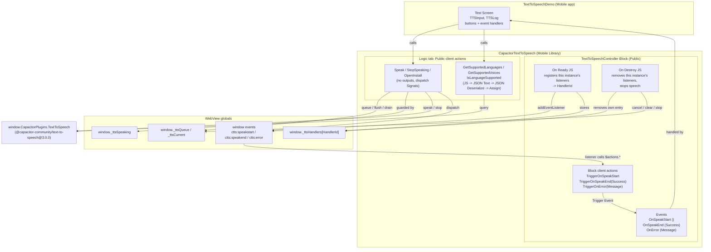

# Design Document

## Overview

CapacitorTextToSpeech is an ODC **Mobile Library** wrapping `@capacitor-community/text-to-speech@3.0.0` (pinned exactly). It exposes six **Public client actions on the Logic tab** and a **Public Block** `TextToSpeechController` that raises the speech events to the consuming screen.

### ODC platform rules this design follows

The full list, with what is confirmed and what is not, is in `.kiro/steering/odc-mobile-rules.md`. The ones that shape this design:

1. Mobile Library and Mobile app are created and built in ODC Studio. The MCP/Mentor cannot create or load them.
2. Public client actions live on the Logic tab. A Block's client actions cannot be Public, cannot have Output parameters, and cannot be called by the parent. The parent cannot read Block variables.
3. Only JavaScript inside a Block can call that Block's client actions through `$actions`, and only Block client actions can Trigger Event.
4. When navigating, the target screen's On Ready runs before the old screen's On Destroy (ODC docs: the old screen is destroyed when the transition ends). Cleanup must be per Block instance.
5. JS nodes use `$parameters` for inputs and outputs and `$resolve()` with no arguments. JS outputs are primitives, so lists return as JSON Text, then JSON Deserialize, then Assign (the pattern ODC's own Capacitor guide recommends).
6. A Decimal input can arrive in JavaScript as an OutSystems decimal object rather than a number, so numeric inputs are converted before use.
7. Public library elements must be marked Public: the Block, the six actions, and the `TTSVoice` structure (used in a Public action's output).

### Plugin behavior this design relies on (v3.0.0 iOS source)

Read from the plugin's `TextToSpeech.swift` and `TextToSpeechPlugin.swift` at tag `v3.0.0`:

- `speak()` rejects with `"This language is not supported."` when `lang` is unsupported. Otherwise its promise resolves when the utterance finishes **or is cancelled**. It never rejects on cancel.
- `stop()` stops the synthesizer and resolves at once. The in-flight `speak()` then resolves through the cancel callback.
- `speak()` itself stops any current utterance before starting. The drain loop never calls `speak()` while another is in flight, so this does not matter here.
- `getSupportedVoices()` returns every voice with `default: false` and `localService: true` on iOS.
- `openInstall()` resolves on iOS.
- The default `category` `ambient` is muted by the iPhone silent switch. `playback` is not.

Because a cancelled `speak()` resolves, the library marks the in-flight item as cancelled before calling `stop()`, so that item ends with `success = false`.

### Architecture summary

- All six actions are Logic-tab Public client actions. The consumer calls them directly.
- `Speak`, `StopSpeaking`, and `OpenInstall` signal through `window` events: `ctts:speakstart`, `ctts:speakend` (`{ success }`), `ctts:error` (`{ message }`).
- The Block has three events, three Trigger helpers, a `HandlerId` local variable, and On Ready / On Destroy JS. On Ready registers this instance's listeners. On Destroy removes only this instance's listeners and stops speech.
- The query actions return their output and dispatch nothing.

## Architecture



Key points:

1. **Signals bridge the Logic tab to the Block.** The Block's listeners call its helper actions through `$actions`, which Trigger the events.
2. **Queue and drain.** `window._ttsQueue` holds pending items. `drainQueue()` speaks them one at a time. `window._ttsSpeaking` stops a second loop from starting. `window._ttsCurrent` is the item being spoken.
3. **Cancellation.** Flush, `StopSpeaking`, and On Destroy set `window._ttsCurrent.cancelled = true` before `stop()`. When the cancelled `speak()` resolves, the loop dispatches `ctts:speakend` with `success = false`. Only the drain loop dispatches `ctts:speakend`, so each item gets exactly one start and one end.
4. **Per-instance listeners.** Each Block instance registers its own listeners under its own `HandlerId` and removes only those. During a screen transition both screens' Blocks receive Signals briefly. That is harmless.
5. **Immediate `$resolve()`** for `Speak`, `StopSpeaking`, `OpenInstall`. Query actions resolve after the plugin promise settles.
6. **Events need the Block on the screen.** Without it, Signals are ignored. The Public actions still work.

## Components and Interfaces

### Extensibility Configuration

```json
{
  "buildConfigurations": {
    "capacitor": {
      "source": {
        "npm": "@capacitor-community/text-to-speech@3.0.0"
      }
    }
  }
}
```

No permissions are needed: text-to-speech has no iOS usage-description or Android permission requirement.

### Structure: TTSVoice (Public = Yes)

| Attribute | Type |
|---|---|
| `VoiceIndex` | Integer |
| `Name` | Text |
| `Lang` | Text |
| `IsDefault` | Boolean |
| `IsLocalService` | Boolean |
| `VoiceURI` | Text |

### Block: TextToSpeechController (Public = Yes)

No Input Parameters. One local variable: `HandlerId` (Text, default `""`).

**Events** (Is Mandatory = No):

| Event | Input Parameters |
|---|---|
| `OnSpeakStart` | none |
| `OnSpeakEnd` | `Success` (Boolean) |
| `OnError` | `Message` (Text) |

**Helper client actions** (inside the Block, each only a Trigger Event):

| Client Action | Input Parameters | Flow |
|---|---|---|
| `TriggerOnSpeakStart` | none | Trigger Event `OnSpeakStart` |
| `TriggerOnSpeakEnd` | `Success` (Boolean) | Trigger Event `OnSpeakEnd`, map `Success` |
| `TriggerOnError` | `Message` (Text) | Trigger Event `OnError`, map `Message` |

**On Ready**: JavaScript node (Text output `HandlerId`), then Assign `HandlerId = JavaScript1.HandlerId`.

```javascript
const id = "ctts-" + Date.now().toString(36) + "-" + Math.random().toString(36).slice(2, 8);

const handlers = {
  start: () => {
    $actions.TriggerOnSpeakStart();
  },
  end: (e) => {
    $actions.TriggerOnSpeakEnd(!!(e.detail && e.detail.success));
  },
  error: (e) => {
    $actions.TriggerOnError(String(e.detail && e.detail.message ? e.detail.message : ""));
  }
};

window._ttsHandlers = window._ttsHandlers || {};
window._ttsHandlers[id] = handlers;
window.addEventListener("ctts:speakstart", handlers.start);
window.addEventListener("ctts:speakend", handlers.end);
window.addEventListener("ctts:error", handlers.error);

$parameters.HandlerId = id;
$resolve();
```

**On Destroy**: JavaScript node (Text input `HandlerId` = the Block variable `HandlerId`).

```javascript
const CapTTS = window.CapacitorPlugins ? window.CapacitorPlugins.TextToSpeech : null;

// Remove only this Block instance's listeners. The next screen's Block has
// already registered its own by the time this runs.
const registry = window._ttsHandlers || {};
const handlers = registry[$parameters.HandlerId];
if (handlers) {
  window.removeEventListener("ctts:speakstart", handlers.start);
  window.removeEventListener("ctts:speakend", handlers.end);
  window.removeEventListener("ctts:error", handlers.error);
  delete registry[$parameters.HandlerId];
}

// Stop speech started on this screen.
if (window._ttsCurrent) {
  window._ttsCurrent.cancelled = true;
}
window._ttsQueue = [];
if (CapTTS) {
  CapTTS.stop().catch(() => {});
}

$resolve();
```

### Public client actions (Logic tab, Public = Yes)

Every JS node reads the plugin the same guarded way:

```javascript
const CapTTS = window.CapacitorPlugins ? window.CapacitorPlugins.TextToSpeech : null;
```

`Speak`, `StopSpeaking`, and `OpenInstall` dispatch Signals with:

```javascript
const emit = (name, detail) => window.dispatchEvent(new CustomEvent(name, { detail }));
```

#### Speak

**Inputs:** `Text` (Text, mandatory), `Lang` (Text, `"en-US"`), `Rate` (Decimal, `1.0`), `Pitch` (Decimal, `1.0`), `Volume` (Decimal, `1.0`), `VoiceIndex` (Integer, `-1`), `Category` (Text, `"ambient"`), `QueueMode` (Integer, `1`: `0 = Flush`, `1 = Add`). The JS node declares the same eight inputs, each set to the action input of the same name.

**Valid ranges on iOS (`AVSpeechUtterance`, not enforced by this plugin or by this action — out-of-range values are silently clamped by iOS):**

| Input | Range | iOS default | Our default | Note |
|---|---|---|---|---|
| `Rate` | `0.0` to `1.0` | `~0.5` (`AVSpeechUtteranceDefaultSpeechRate`) | `1.0` | Our default is iOS's *maximum* speed, not its natural/default pace. Values outside `0.0`-`1.0` are pinned to that range by iOS. |
| `Pitch` | `0.5` to `2.0` | `1.0` | `1.0` | Matches iOS's default. Values outside `0.5`-`2.0` are clamped by iOS. |
| `Volume` | `0.0` to `1.0` | `1.0` | `1.0` | Matches iOS's default. **`Volume` only attenuates relative to the device's current system/media output volume — it cannot exceed or override the physical volume setting.** If the device volume is turned down, speech will be quiet regardless of this input. There is no API path (in this plugin or in `AVSpeechUtterance`) for an app to override the user's physical volume. |

These ranges and the volume caveat are iOS/`AVSpeechUtterance` facts, confirmed from Apple's API surface and corroborated by developer reports of the same clamping/relative-volume behavior. They are not implemented as validation in `Speak` — the action passes the raw numeric values through to the plugin, and iOS does the clamping.

```javascript
const emit = (name, detail) => window.dispatchEvent(new CustomEvent(name, { detail }));
const CapTTS = window.CapacitorPlugins ? window.CapacitorPlugins.TextToSpeech : null;

// OutSystems may pass Decimal values as objects, not numbers.
const toNum = (v) => (v != null && typeof v.toNumber === "function") ? v.toNumber() : Number(v);
const positiveOr = (v, fallback) => {
  const n = toNum(v);
  return Number.isFinite(n) && n > 0 ? n : fallback;
};

if (!CapTTS) {
  emit("ctts:error", { message: "TextToSpeech plugin not found on window.CapacitorPlugins." });
  $resolve();
  return;
}

const text = $parameters.Text == null ? "" : String($parameters.Text);
if (text.trim() === "") {
  emit("ctts:error", { message: "Text is required." });
  $resolve();
  return;
}

// v3.0.0 has no native queueStrategy, so implement the queue ourselves.
window._ttsQueue = window._ttsQueue || [];

const item = {
  text: text,
  lang: $parameters.Lang || "en-US",
  rate: positiveOr($parameters.Rate, 1.0),
  pitch: positiveOr($parameters.Pitch, 1.0),
  volume: positiveOr($parameters.Volume, 1.0),
  category: $parameters.Category || "ambient"
};
const voiceIndex = toNum($parameters.VoiceIndex);
if (Number.isInteger(voiceIndex) && voiceIndex >= 0) {
  item.voice = voiceIndex;
}

if (toNum($parameters.QueueMode) === 0) {
  // Flush: drop pending items and cut off the current one. A cancelled
  // speak() resolves on iOS, so mark it to report success = false.
  window._ttsQueue = [];
  if (window._ttsCurrent) {
    window._ttsCurrent.cancelled = true;
  }
  CapTTS.stop().catch(() => {});
}
window._ttsQueue.push(item);

async function drainQueue() {
  if (window._ttsSpeaking) return; // a loop is already running
  window._ttsSpeaking = true;
  try {
    while (window._ttsQueue.length > 0) {
      const next = window._ttsQueue.shift();
      window._ttsCurrent = next;
      emit("ctts:speakstart");
      let ok = true;
      try {
        await CapTTS.speak(next);
      } catch (err) {
        ok = false;
        emit("ctts:error", { message: String(err && err.message ? err.message : err) });
      }
      window._ttsCurrent = null;
      emit("ctts:speakend", { success: ok && !next.cancelled });
    }
  } finally {
    window._ttsCurrent = null;
    window._ttsSpeaking = false;
  }
}

drainQueue();
$resolve();
```

#### StopSpeaking

No inputs.

```javascript
const emit = (name, detail) => window.dispatchEvent(new CustomEvent(name, { detail }));
const CapTTS = window.CapacitorPlugins ? window.CapacitorPlugins.TextToSpeech : null;

if (!CapTTS) {
  emit("ctts:error", { message: "TextToSpeech plugin not found on window.CapacitorPlugins." });
  $resolve();
  return;
}

// Clear pending items and mark the current one cancelled. The drain loop
// dispatches its ctts:speakend (success = false) when speak() resolves.
window._ttsQueue = [];
if (window._ttsCurrent) {
  window._ttsCurrent.cancelled = true;
}
CapTTS.stop().catch((err) => {
  emit("ctts:error", { message: String(err && err.message ? err.message : err) });
});

$resolve();
```

#### OpenInstall

No inputs. Android-only in the plugin, resolves on iOS.

```javascript
const emit = (name, detail) => window.dispatchEvent(new CustomEvent(name, { detail }));
const CapTTS = window.CapacitorPlugins ? window.CapacitorPlugins.TextToSpeech : null;

if (!CapTTS) {
  emit("ctts:error", { message: "TextToSpeech plugin not found on window.CapacitorPlugins." });
  $resolve();
  return;
}

CapTTS.openInstall().catch((err) => {
  // Documented Android-only call, so a rejection is not surfaced as an error.
  console.warn("openInstall: " + String(err && err.message ? err.message : err));
});

$resolve();
```

#### GetSupportedLanguages (confirmed in Studio)

**Output:** `Languages` (Text List). **Flow:** JavaScript node (Text output `LanguagesJSON`), JSON Deserialize (`JavaScript1.LanguagesJSON`, `Text List`), Assign `Languages = JSONDeserialize1.Data`.

```javascript
const CapTTS = window.CapacitorPlugins ? window.CapacitorPlugins.TextToSpeech : null;

if (!CapTTS) {
  $parameters.LanguagesJSON = "[]";
  $resolve();
  return;
}

CapTTS.getSupportedLanguages()
  .then((result) => {
    const langs = result.languages || [];
    $parameters.LanguagesJSON = JSON.stringify(langs);
    $resolve();
  })
  .catch((err) => {
    console.error("Capacitor TTS getSupportedLanguages error:", err);
    $parameters.LanguagesJSON = "[]";
    $resolve();
  });
```

#### GetSupportedVoices

**Output:** `Voices` (`TTSVoice` List). **Flow:** JavaScript node (Text output `VoicesJSON`), JSON Deserialize (`JavaScript1.VoicesJSON`, `TTSVoice List`), Assign `Voices = JSONDeserialize1.Data`.

```javascript
const CapTTS = window.CapacitorPlugins ? window.CapacitorPlugins.TextToSpeech : null;

if (!CapTTS) {
  $parameters.VoicesJSON = "[]";
  $resolve();
  return;
}

CapTTS.getSupportedVoices()
  .then((result) => {
    const voices = (result.voices || []).map((v, idx) => ({
      VoiceIndex: idx,
      Name: v.name || "",
      Lang: v.lang || "",
      IsDefault: !!v.default,
      IsLocalService: !!v.localService,
      VoiceURI: v.voiceURI || ""
    }));
    $parameters.VoicesJSON = JSON.stringify(voices);
    $resolve();
  })
  .catch((err) => {
    console.error("Capacitor TTS getSupportedVoices error:", err);
    $parameters.VoicesJSON = "[]";
    $resolve();
  });
```

The keys must match the `TTSVoice` attribute names exactly. On iOS every voice has `IsDefault = false` and `IsLocalService = true`.

#### IsLanguageSupported

**Input:** `Lang` (Text). **Output:** `Supported` (Boolean). **Flow:** JavaScript node (Text input `Lang`, Boolean output `Supported`), Assign `Supported = JavaScript1.Supported`.

```javascript
const CapTTS = window.CapacitorPlugins ? window.CapacitorPlugins.TextToSpeech : null;

if (!CapTTS) {
  $parameters.Supported = false;
  $resolve();
  return;
}

CapTTS.isLanguageSupported({ lang: $parameters.Lang })
  .then((result) => {
    $parameters.Supported = !!result.supported;
    $resolve();
  })
  .catch((err) => {
    $parameters.Supported = false;
    $resolve();
  });
```

## Data Models

### Queue item (`window._ttsQueue` elements)

```javascript
{
  text: String($parameters.Text),             // non-empty after trim
  lang: $parameters.Lang || "en-US",
  rate: positiveOr($parameters.Rate, 1.0),
  pitch: positiveOr($parameters.Pitch, 1.0),
  volume: positiveOr($parameters.Volume, 1.0),
  category: $parameters.Category || "ambient",
  voice: VoiceIndex                            // only when an integer >= 0
}
```

`positiveOr` converts with `toNum` (handles OutSystems decimal objects) and falls back when the result is not a finite number greater than 0. A Volume of 0 therefore becomes 1.0, as in the original contract. The in-flight item may gain `cancelled: true` after it leaves the queue.

### WebView globals

| Global | Purpose |
|---|---|
| `window._ttsQueue` | Pending items |
| `window._ttsCurrent` | Item being spoken, or `null` |
| `window._ttsSpeaking` | Drain loop running |
| `window._ttsHandlers` | `HandlerId` to `{ start, end, error }` listeners |

### Signals

| Event | `detail` |
|---|---|
| `ctts:speakstart` | none |
| `ctts:speakend` | `{ success: Boolean }` |
| `ctts:error` | `{ message: String }` |

## Correctness Properties

The queue, drain, Signal, and JSON-output logic is plain JavaScript with a mockable plugin. The harness supplies a mock `window.CapacitorPlugins.TextToSpeech`, `$parameters`, a `$resolve` spy, `$actions` spies, and records `window.dispatchEvent`. JSON Deserialize, Assign, Trigger Event, and real audio are checked in Studio and on the device.

### Property 1: Add preserves FIFO order
*For any* prior queue and new item, `Speak` with `QueueMode != 0` leaves the queue equal to the prior queue with the new item last.
**Validates: Requirements 6.6**

### Property 2: Flush clears, cancels the current item, stops, then enqueues
*For any* prior queue and current item, `Speak` with `QueueMode = 0` leaves the queue containing exactly the new item, marks the current item (if any) `cancelled`, and calls `stop()`.
**Validates: Requirements 6.5**

### Property 3: Queue item field fallbacks
*For any* inputs, including decimal objects with `toNumber()`, the item uses `Lang` or `"en-US"`, `Category` or `"ambient"`, and for `rate`, `pitch`, `volume` the numeric value when it is finite and greater than 0, otherwise `1.0`.
**Validates: Requirements 6.3**

### Property 4: voice present iff VoiceIndex is a non-negative integer
*For any* `VoiceIndex`, the item has `voice` equal to it when and only when it is an integer `>= 0`.
**Validates: Requirements 6.4**

### Property 5: Exactly one start and one end per drained item
*For any* sequence of item outcomes (resolve, reject, or cancelled-then-resolve), each item produces exactly one `ctts:speakstart` before its `speak()` and exactly one `ctts:speakend`, with `success = true` only if `speak()` resolved and the item was not cancelled. A rejection dispatches `ctts:error` with the message before that item's `ctts:speakend`.
**Validates: Requirements 3.2, 3.4, 3.5, 3.7, 6.9, 6.10, 6.11**

### Property 6: Single drain loop, guard released
*For any* overlapping `Speak` calls, at most one loop runs, each item is spoken exactly once in order, and when the queue empties `_ttsSpeaking` is `false` and `_ttsCurrent` is `null`.
**Validates: Requirements 6.8, 6.12**

### Property 7: StopSpeaking clears, cancels, and never ends twice
*For any* prior queue, `StopSpeaking` empties the queue before `stop()`, dispatches no `ctts:speakend` itself, and the in-flight item (if any) ends with exactly one `ctts:speakend` with `success = false`. When idle, no `ctts:speakend` is dispatched.
**Validates: Requirements 7.2, 7.3, 15.4**

### Property 8: Plugin-undefined guard
*For any* Public action with `window.CapacitorPlugins` or its `TextToSpeech` undefined, the action does not throw and calls no plugin method. `Speak`, `StopSpeaking`, `OpenInstall` dispatch `ctts:error` once with the plugin-not-found message. The query actions dispatch nothing and output `"[]"`, `"[]"`, or `false`.
**Validates: Requirements 5.1, 5.2, 5.3, 6.13, 7.6, 8.5, 9.6, 10.3, 11.3**

### Property 9: Query result and error mapping
*For any* resolution, `LanguagesJSON` is `JSON.stringify(result.languages || [])` and `Supported` is `!!result.supported`. *For any* rejection, the output is `"[]"` or `false` and nothing is dispatched.
**Validates: Requirements 8.2, 8.3, 8.4, 10.2, 10.4**

### Property 10: Voices JSON order and mapping
*For any* `voices` array, the parsed `VoicesJSON` has one object per voice in order, with `VoiceIndex` equal to the index and the five fields mapped and coerced. Missing or empty yields `"[]"`. A rejection yields `"[]"`.
**Validates: Requirements 9.3, 9.4, 9.5**

### Property 11: Resolve timing
`Speak`, `StopSpeaking`, `OpenInstall` call `$resolve()` before their plugin promises settle. The query actions call `$resolve()` only after.
**Validates: Requirements 6.7, 7.5, 8.6, 11.2**

### Property 12: OpenInstall rejection is warned, not signalled
*For any* rejection of `openInstall()`, the action calls `console.warn` with the message and dispatches no `ctts:error`.
**Validates: Requirements 11.4**

### Property 13: Empty text is rejected
*For any* `Text` that is empty or whitespace, `Speak` dispatches `ctts:error` with `"Text is required."`, leaves the queue unchanged, calls no plugin method, and resolves.
**Validates: Requirements 6.14, 15.6**

## Error Handling

| Situation | Behavior |
|---|---|
| Plugin missing (Speak, StopSpeaking, OpenInstall) | `ctts:error` "TextToSpeech plugin not found on window.CapacitorPlugins.", resolve |
| Plugin missing (query actions) | Default output, nothing dispatched |
| Empty `Text` | `ctts:error` "Text is required.", nothing queued |
| `speak()` rejects (e.g. unsupported language) | `ctts:error` with the message, then `ctts:speakend` false, loop continues |
| Item cancelled by Flush, Stop, or On Destroy | `ctts:speakend` false when its `speak()` resolves |
| `stop()` rejects in StopSpeaking | `ctts:error` with the message |
| `stop()` rejects in Flush or On Destroy | Ignored |
| `openInstall()` rejects | `console.warn`, nothing dispatched |
| Query promise rejects | `console.error` (languages, voices), default output |
| Unexpected error inside the drain loop | `finally` releases `_ttsSpeaking` and `_ttsCurrent` |

Known limit: if the native layer never settles a `speak()` call, the loop waits forever and later `Speak` calls only queue. The v3.0.0 source resolves on both finish and cancel, so this is not expected. On-device scenario 4 checks it.

## Testing Strategy

- **Property-based tests (fast-check, at least 100 runs each)** for Properties 1 to 13, one test per property, tagged `Feature: CapacitorTextToSpeech, Property {n}: {text}`.
- **Example-based tests**: lazy queue init; On Ready registers three listeners, outputs a `HandlerId`, and each Signal calls the matching `$actions` helper with the mapped payload; On Destroy removes only its own listeners (instance B registered before instance A is destroyed keeps receiving Signals), cancels, clears, stops, and resolves last.
- **Harness**: each reference JS file (task 6) runs as the body of an async function with `$parameters`, `$resolve`, `$actions` as arguments. Node 24 provides `EventTarget` and `CustomEvent`, so `window` is an `EventTarget` with recorded `dispatchEvent`. Globals are reset between runs.
- **Studio checks**: JSON Deserialize into `Text List` (done) and `TTSVoice List`; Assign of each JS output; `$actions.TriggerOn*` offered inside the Block's On Ready node.
- **On-device checks**: real audio, the Signal to Block event path after the action resolved, navigation with the Block on two screens, silent switch.

### iOS on-device validation

Silent switch off, or `Category = "playback"`.

1. **Single speak**: `OnSpeakStart`, audio, `OnSpeakEnd(True)`.
2. **Sequential Add**: two quick `Speak` calls play in order, one `OnSpeakEnd(True)` each.
3. **Flush mid-utterance**: current phrase cut off with `OnSpeakEnd(False)`, new phrase plays and ends `True`.
4. **Stop mid-utterance**: audio stops, exactly one `OnSpeakEnd(False)`, nothing else plays. A later `Speak` still works.
5. **Voice selection**: a non-default `VoiceIndex` changes the voice.
6. **Errors**: empty `Text` gives `OnError("Text is required.")`. `Lang = "xx-XX"` gives `OnError("This language is not supported.")` then `OnSpeakEnd(False)`.
7. **Event bridge and navigation**: events arrive after the action resolved, and still arrive after navigating to another screen with the Block and back.

### TextToSpeechDemo test-screen wiring

0. TextToSpeechDemo is an ODC Mobile app, created in ODC Studio.
1. Add the `CapacitorTextToSpeech` dependency (six Public actions, `TTSVoice`, `TextToSpeechController`). Place one Block on the test screen and handle its three events.
2. Screen variables `TTSInput` (Text) and `TTSLog` (Text, `""`). An Input widget displays and edits `TTSInput`; an Expression (or multi-line Text display) widget displays `TTSLog`, since nothing renders a Text variable automatically.
3. **Speak** button: `Speak(Text = TTSInput, QueueMode = 1)`.
4. **Flush** button: `Speak(Text = TTSInput, QueueMode = 0)`.
5. **Stop** button: `StopSpeaking`.
6. **Voices** button: `GetSupportedVoices`, bound to a list from which a `VoiceIndex` can be picked and passed to `Speak`.
7. `OnSpeakStart` appends `"Speaking started"`, `OnSpeakEnd` appends `"Speaking ended, success=" + Success`, `OnError` appends `"ERROR: " + Message` and shows an Error Feedback Message.

## Publishing and Build

1. Publish the mobile library from Studio when complete and the local tests pass.
2. Wire and publish TextToSpeechDemo from Studio after the library publish finishes.
3. Build the iOS package from the ODC Portal with MABS 12.1 and the Capacitor runtime.
4. Confirm the build log shows `CapacitorCommunityTextToSpeech` linked, then install on the iPhone.

Publish a module again only after its previous publish has finished.
